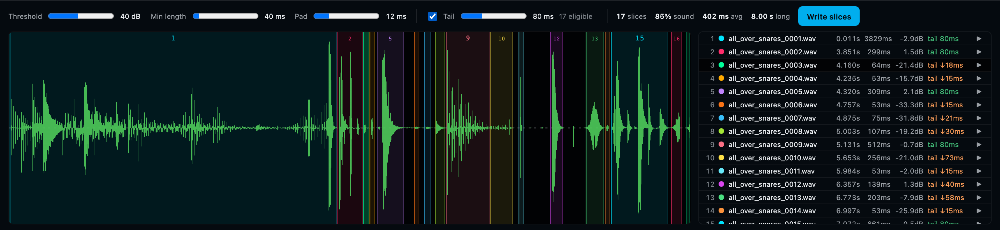

# Chop

Recycle Reborn ([rjvaleo/Recycle-Reborn](https://github.com/rjvaleo/Recycle-Reborn)), as a tab in the dock.

It cuts the selected sound at its silences into slices, shows them as
coloured regions on the waveform, plays each one, gives each an optional
ReCycle-style ping-pong loop tail, and writes them out as 16-bit WAVs.

## What is Recycle Reborn's, unchanged

These are copied line for line into `ui/chop.js`:

- the RMS frames;
- the silence detection;
- the tail rules (at most 28% of the slice, at least 10 ms, 2 to 8 cycles);
- the ping-pong tail with its crossfade and taper;
- the WAV encoder;
- the defaults (40 dB, 40 ms, 12 ms; tail 80 ms);
- the slice colours;
- the names (`<sound>_0001.wav`).

`tests/ui/chop.spec.mjs` runs them on a fixed signal and checks the result
against the original's own output on the same signal.

## What is this app's

- **The sound** is the selected one, read through `/audio`. That route hands
  back WAV for every format, so the original's AIFF parser isn't needed.
- **A slice plays through the engine** from its start and stops at its end.
  The panel has no Web Audio context of its own.
- **Write slices** puts every slice beside the sound, in `<sound> slices/`, through
  `POST /api/chop/save`. The slices are in the library straight away: in
  Browse, on the sound map, ready to play.
  - **Nothing is overwritten.** Chopping again with other settings adds
    `… (2).wav` beside the last pass.
  - **The route writes nowhere else.** `core/crates/server/tests/chop.rs`
    covers it.

Downloading a ZIP, the original's export, is not carried over.
