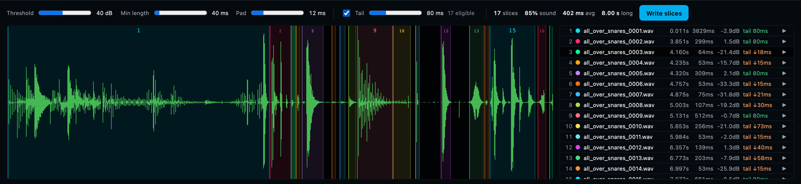

# Chop

Recycle Reborn ([rjvaleo/Recycle-Reborn](https://github.com/rjvaleo/Recycle-Reborn)), as a page of its own.

It cuts the selected sound into slices, shows them on the page's own waveform,
plays each one, gives each an optional
ReCycle-style ping-pong loop tail, and writes them out as 16-bit WAVs.

## The page (redesigned 8 Nov 2026)

The design is `chop-redesign/ARCHITECTURE.md` in the work folder; the approved
mock-up is `chop-v3.html` there. 
Since 13 Nov 2026 the waveform runs the full width of the page (RJ: "the
waveform should be full width. Those slices are good, but they can go someplace
else"). The SLICES list sits under it, beside THE PICKED SLICE and THE PASS.

What matters for working on it:

| File | What it does |
|---|---|
| `ui/app/400-chop-cut.js` | Finding the cuts and editing them; Recycle Reborn's code |
| `ui/app/401-chop-sound.js` | What a slice sounds like, listening, writing |
| `ui/app/402-chop-listen.js` | The measures, the tempo and the bars, what a slice is |
| `ui/app/403-chop-view.js` | The overview, the detail and its overlay, the colours |
| `ui/app/404-chop-pictures.js` | The picked slice, the pass, the processing curves |
| `ui/app/405-chop-panel.js` | The list, the knobs, the processing modules |
| `ui/app/406-chop-page.js` | Wiring, the Looks' bridge to the themes, the fit |
| `ui/chop.css` | All of it, scoped under `.chop-app` |

- **Fixed at 1432×1000 and scaled whole**, as Wave is (`chopFit`).
- **The file tabs are the app's own**, moved in while the page shows and put back after (`chopBorrow`). The transport is the Now Playing bar's, above every page (`docs/EDIT-PAGE.md`). There is one set of each.
- **The detail is the page's own** (`#chopLane`, `chopView`). The main waveform is hidden on this page.
- **Nothing hides by mode.** A knob that makes no cuts dims and still works. Ratchet uses Nudge and Shuffle in every mode.
- **The Colour row** says what the colour on the waveform means, from the library's own measures (`search/src/lib.rs`, `pitch.rs`), taken in a worker on every 11 ms. Every slice is measured too and given a Kind, which is an opinion and will sometimes be wrong.
- **Detect** finds the tempo and counts the bars between S and E, and sets Bars and Beats. It runs when a sound opens. Whole bars win when they score nearly as well, so a loop loops even.
- **Bars reaches 999** on a log knob, so a song can be counted. Ratchet's loop is capped at 64 bars.
- **Looks** are Grain v12's five, and since 11 Nov 2026 they are themes (`ui/theme-palettes.js`), chosen on the Theme page; Chop has no switch of its own. Its colours are the shared look's (`ui/app-css/015-tokens.css`) under its own names, so every theme reaches it. The theme's "on", orange by default, means on in all five.
- **Processing controls are `param` sliders with a knob over them** (`chopBar`), so they stay what they were for keyboard, reset and `controls-parity`.

## What is Recycle Reborn's, unchanged

These are copied line for line into `ui/app/400-chop-cut.js`:

- the RMS frames;
- the silence detection;
- the tail rules (at most 28% of the slice, at least 10 ms, 2 to 8 cycles);
- the ping-pong tail with its crossfade and taper;
- the WAV encoder;
- the defaults (40 dB, 40 ms, 12 ms; tail 80 ms);
- the slice colours;
- the names (`<sound>_0001.wav`).

`tests/ui/chop.spec.mjs` runs them on a fixed signal and checks the result
against the original's own output on the same signal.

## What is this app's

- **The sound** is the selected one, read through `/audio`. That route hands
  back WAV for every format, so the original's AIFF parser isn't needed.
- **A slice plays through the engine** from its start and stops at its end.
  The panel has no Web Audio context of its own.
- **Write slices** puts every slice beside the sound, in `<sound> slices/`, through
  `POST /api/chop/save`. The slices are in the library straight away: in
  Browse, on the sound map, ready to play.
  - **Nothing is overwritten.** Chopping again with other settings adds
    `… (2).wav` beside the last pass.
  - **The route writes nowhere else.** `core/crates/server/tests/chop.rs`
    covers it.

Downloading a ZIP, the original's export, is not carried over.
